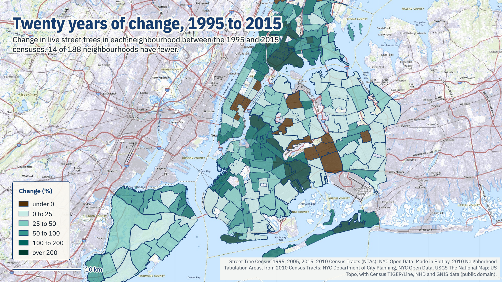
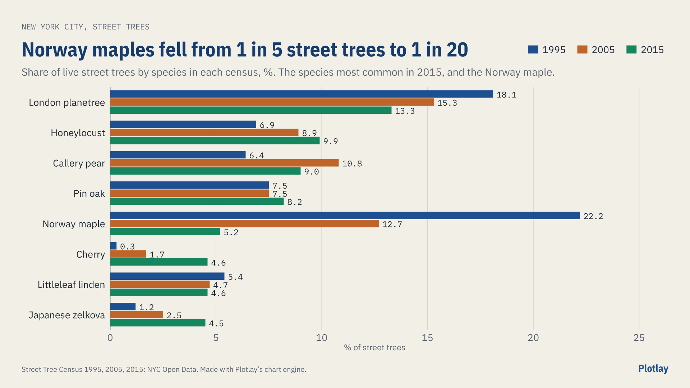

# Twenty years of New York City street trees

New York City's three street tree censuses, 1995, 2005 and 2015, compared neighbourhood by neighbourhood: every live tree placed by its own position. **Live version, with an interactive map:** [getplotlay.com/showcase/nyc-street-trees](https://www.getplotlay.com/showcase/nyc-street-trees/)



Every ten years Parks staff and volunteers have walked every block and recorded every street tree. **The censuses counted 482,509 live street trees in 1995, 584,252 in 2005 and 652,173 in 2015: 169,664 more (+35.2%) in twenty years.** 174 of 188 neighbourhoods have more, 51 at least twice as many, and 14 have fewer. This is measured change: what each census recorded, counted the same way.

The city publishes each census as its own table with its own columns, but not a comparison: the 1995 table names its neighbourhoods by a code the 2005 table leaves blank for 24,000 trees, and species are spelled differently in each. Here every tree is placed by its own latitude and longitude, and [Plotlay](https://www.getplotlay.com) puts the three censuses on one map with a slider.

[](https://app.plotlay.io/?example=nyc-street-trees&as=client)

## What the data says

| Borough | 1995 | 2005 | 2015 | Change |
|---|---|---|---|---|
| Bronx | 41,830 | 57,070 | 78,894 | +88.6% |
| Brooklyn | 106,540 | 140,041 | 167,857 | +57.6% |
| Manhattan | 42,289 | 49,018 | 61,483 | +45.4% |
| Queens | 201,826 | 230,417 | 235,767 | +16.8% |
| Staten Island | 72,631 | 97,568 | 101,443 | +39.7% |

- **The Bronx and Brooklyn gained most.** The Bronx has 89% more street trees than in 1995; Queens, which had the most to start with, 17% more.
- **East New York, tree by tree.** Its three neighbourhoods went from 5,370 street trees to 6,717 and then 15,402 (+187%). The largest gain anywhere was East New York (2,892 to 9,162).
- **Norway maples went from 1 in 5 to 1 in 20.** 106,909 in 1995, 34,189 in 2015. London planetrees are still the most common, but their share fell from 18.1% to 13.3% as more kinds were planted.



### Read it carefully

- **A tree is a live record.** Dead trees, stumps, shafts and planting spaces are left out of every census.
- **The censuses were run differently.** 1995 positions were worked out later from addresses; 30,193 of its trees could not be placed and 15,778 go to the neighbourhood the census named. In 2005, 8,715 trees have neither a position nor a neighbourhood and count only citywide. A small difference in one neighbourhood can be method rather than trees.
- **Neighbourhoods are the 2010 Neighborhood Tabulation Areas**, dissolved from the 2010 census tracts. Parks, cemeteries and airports are left out of the map; the trees counted in them are in `citywide.csv`.
- **Street trees only.** Park trees and trees on private land are not in the censuses, so this is not tree canopy. The [Melbourne canopy showcase](https://www.getplotlay.com/showcase/melbourne-canopy/) looks at shade.

## How it was made with Plotlay

1. **A map project** on the USGS National Map topo base map (public domain), and a **Data layer**.
2. **Neighbourhoods: Take all** from the neighbourhood file, with its licence: 188 areas in one step, keyed by their own `nta` code.
3. **Link by key** the trees in each census as a **time axis** (1995, 2005, 2015) and the change 1995 to 2015.
4. **Place by position** every tree in East New York, shown as **dots that follow the slider**.
5. **Colour** by trees per km² in each census, then by the change, diverging round zero.
6. **Charts and map pictures** in the Analysis workspace, each exported as PNG; the species chart drawn by Plotlay's chart engine from the species table.
7. **Export** GeoJSON, TopoJSON, CSV with WKT and the linked data. Nothing here comes from OpenStreetMap.

## What's here

| Folder | What |
|---|---|
| [`data/geometry/`](data/geometry) | The neighbourhoods (key `nta`): GeoJSON, TopoJSON, CSV with WKT |
| [`data/tables/`](data/tables) | `trees_by_census.csv`, `change_1995_2015.csv`, `species.csv`, `citywide.csv` |
| [`data/trees/`](data/trees) | `east_new_york_trees.csv`: every placed tree in East New York's three neighbourhoods, each census |
| [`python/`](python) | A narrated notebook that recomputes every number here: [`street_trees.ipynb`](python/street_trees.ipynb) |
| [`powerbi/`](powerbi) | A Power BI Project (`.pbip`). Start with [`powerbi/OPEN-ME.md`](powerbi/OPEN-ME.md) |
| [`visuals/`](visuals) | The map pictures and charts, made in Plotlay |

### Run the notebook

```
python3 -m venv .venv
.venv/bin/pip install -r python/requirements.txt
cd python && ../.venv/bin/jupyter lab street_trees.ipynb
```

## Sources and licences

- **Code** (notebook, Power BI project): MIT, see [`LICENSE`](LICENSE).
- **Our data** (the tables and shapes): CC BY 4.0, see [`LICENSE-DATA`](LICENSE-DATA). Credit "Plotlay (getplotlay.com)" and NYC Open Data.
- 1995, 2005 and 2015 Street Tree Census: NYC Department of Parks and Recreation, NYC Open Data. 2010 Census Tracts: NYC Department of City Planning, NYC Open Data. NYC Open Data is published with no restrictions on use (NYC Admin Code 23-502); the wording is quoted in [`NOTICE`](NOTICE).
- Base map in the app: USGS The National Map, US Topo (public domain).

This is independent work using open data, not endorsed by the City of New York.
